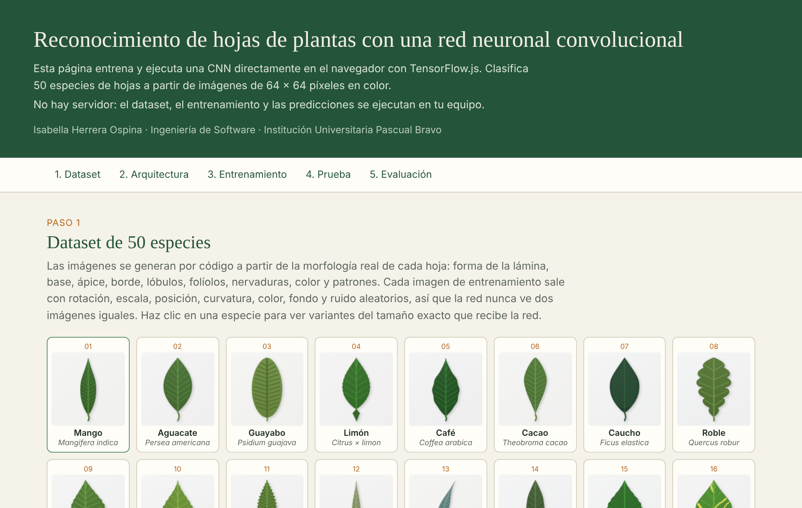

# Reconocimiento de hojas de plantas con una CNN

Red neuronal convolucional que reconoce 50 especies de hojas directamente en el navegador, hecha con TensorFlow.js.

**Ver la página:** https://Dmadrid-g.github.io/reconocimiento-hojas-cnn/

## Qué hace

- Genera por código un dataset de 50 especies de hojas (mango, aguacate, cacao, arce, monstera, ginkgo, helecho, pino, entre otras). Cada imagen sale con rotación, escala, color, fondo y ruido aleatorios.
- Trae un modelo ya entrenado que acierta el 97,8 % de las veces con 1000 imágenes de validación (top-3: 100 %).
- Permite entrenar la red desde cero en el navegador, con gráficas de pérdida y exactitud en vivo.
- Clasifica hojas nuevas o imágenes subidas por el usuario y muestra el top 5 de predicciones.
- Muestra la matriz de confusión y las especies que más se confunden.

## Arquitectura

| Capa | Salida |
|---|---|
| Entrada | 64 × 64 × 3 |
| Conv 3×3 (16) + ReLU, MaxPool 2×2 | 32 × 32 × 16 |
| Conv 3×3 (32) + ReLU, MaxPool 2×2 | 16 × 16 × 32 |
| Conv 3×3 (64) + ReLU, MaxPool 2×2 | 8 × 8 × 64 |
| Conv 3×3 (96) + ReLU, MaxPool 2×2 | 4 × 4 × 96 |
| Aplanado + Densa 128 + ReLU + Dropout 30 % | 128 |
| Densa + Softmax | 50 |

Total: 263 922 parámetros. Optimizador Adam, pérdida de entropía cruzada categórica.

## Tecnologías

HTML, CSS, JavaScript y TensorFlow.js 4.22. Todo está en un solo archivo (`index.html`) y no necesita servidor.

## Autora

Daniel Madrid Giraldo · Ingeniería de Software · Institución Universitaria Pascual Bravo
